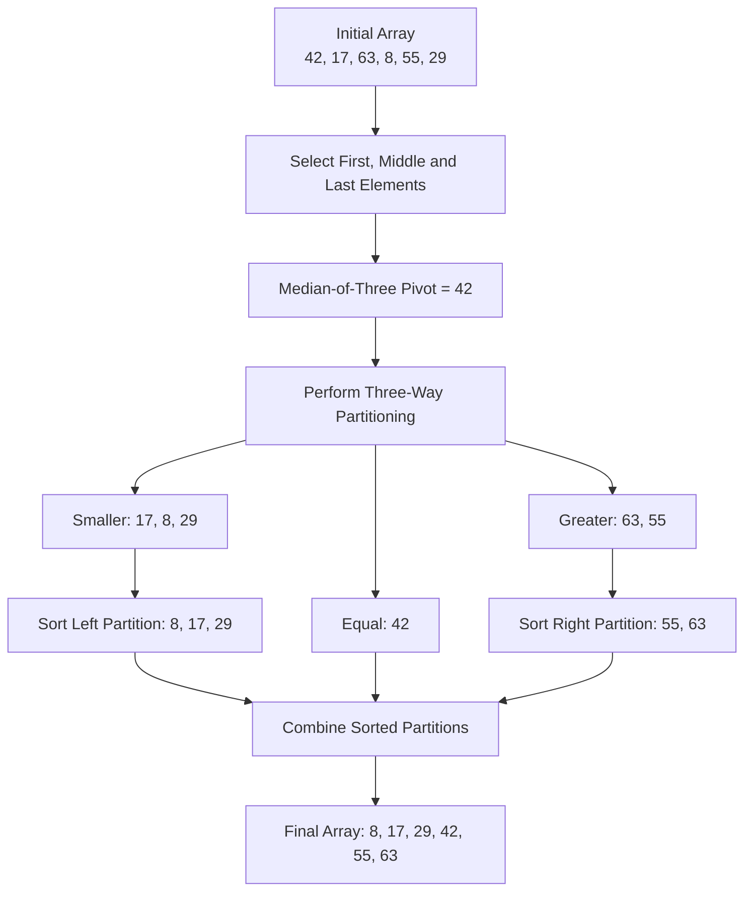
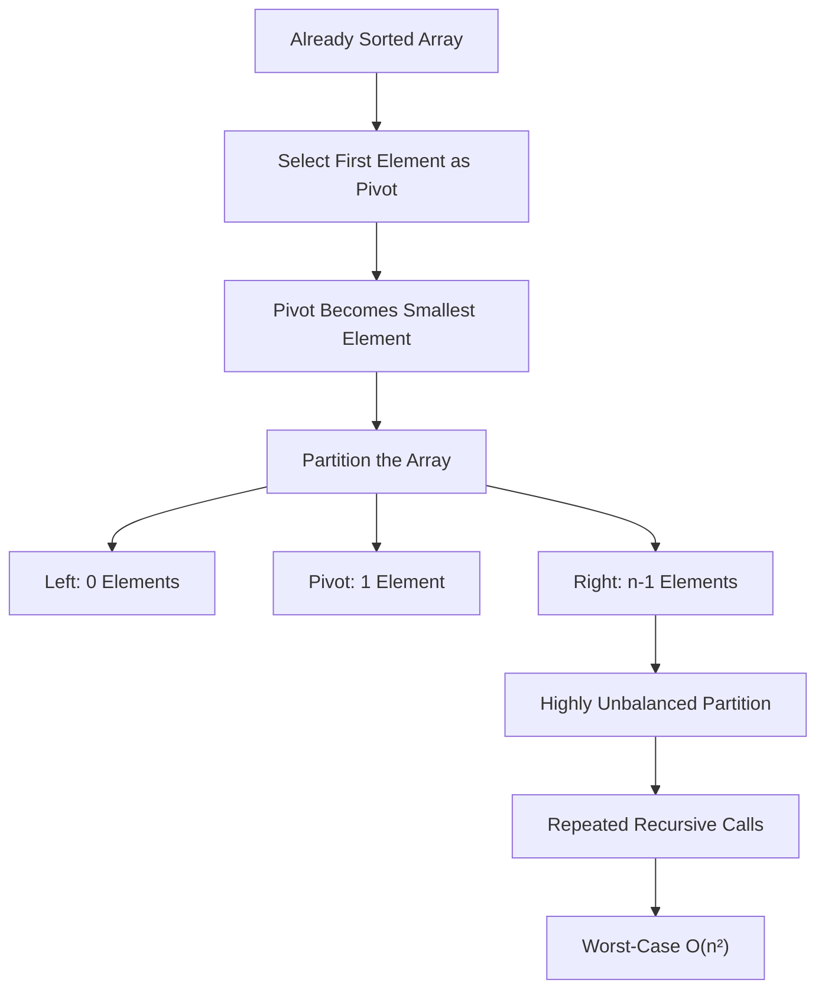
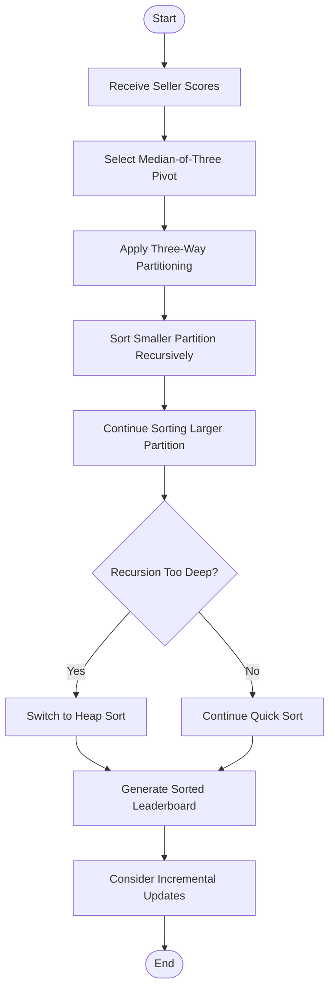

# MODULE 2 – QUICK SORT FOR THE LIVE SELLER LEADERBOARD

## 1. Aim

To implement Quick Sort using the Divide-and-Conquer technique to arrange seller scores in ascending order and improve sorting performance by selecting a better pivot strategy.

## 2. Problem Statement

KartIQ maintains a leaderboard containing 100,000 sellers. Their scores are updated frequently, and the leaderboard must be sorted every few seconds.

The existing implementation selects the first element as the pivot. Since seller scores are usually nearly sorted, this strategy can create highly unbalanced partitions and cause the leaderboard to freeze.

### Sample Dataset

```text
42, 17, 63, 8, 55, 29
```

## 3. Algorithm Explanation

Quick Sort is a Divide-and-Conquer algorithm that sorts an array by selecting a pivot and partitioning the elements around it.

### Three Operations

**1. Divide**

- Select a pivot element.
- Place smaller elements on the left side.
- Place larger elements on the right side.

**2. Conquer**

- Recursively sort the left partition.
- Recursively sort the right partition.

**3. Combine**

- The partitions are already positioned correctly around the pivot.
- No separate merging operation is necessary.
- The final array becomes sorted.

## 4. Pseudocode

### Algorithm 1: QUICK_SORT

```text
QUICK_SORT(A, low, high)

    IF low < high THEN

        pivot = MEDIAN_OF_THREE(
                    A[low],
                    A[mid],
                    A[high]
                )

        (lt, gt) = THREE_WAY_PARTITION(
                      A, low, high, pivot
                  )

        QUICK_SORT(A, low, lt - 1)

        QUICK_SORT(A, gt + 1, high)

    END IF

END
```

### Algorithm 2: THREE_WAY_PARTITION

```text
THREE_WAY_PARTITION(A, low, high, pivot)

    lt = low

    i = low

    gt = high

    WHILE i <= gt

        IF A[i] < pivot THEN

            SWAP A[lt] AND A[i]

            lt = lt + 1

            i = i + 1

        ELSE IF A[i] > pivot THEN

            SWAP A[i] AND A[gt]

            gt = gt - 1

        ELSE

            i = i + 1

        END IF

    END WHILE

    RETURN (lt, gt)

END
```

## 5. Improved Pivot Strategy

The original implementation uses the first element as the pivot.

This is inefficient for nearly sorted data because the first element may repeatedly become the smallest or largest element.

The improved implementation uses:

### Median-of-Three Pivot Selection

Three elements are selected:

- First element
- Middle element
- Last element

The median of these three values is selected as the pivot.

### Three-Way Partitioning

Elements are separated into three groups:

1. Elements smaller than the pivot.
2. Elements equal to the pivot.
3. Elements greater than the pivot.

This is particularly useful when many sellers have identical scores.

## 6. Flowchart


## 7. Complete C Program

**File name:** `quick_sort.c`

The following implementation uses median-of-three pivot selection and three-way partitioning.

```c
#include <stdio.h>
#include <stdlib.h>

void swap(int *a, int *b)
{
    int temp = *a;
    *a = *b;
    *b = temp;
}

int medianOfThree(int a[], int low, int high)
{
    int mid = low + (high - low) / 2;

    if (a[low] > a[mid])
        swap(&a[low], &a[mid]);

    if (a[low] > a[high])
        swap(&a[low], &a[high]);

    if (a[mid] > a[high])
        swap(&a[mid], &a[high]);

    return a[mid];
}

void quickSort(int a[], int low, int high)
{
    while (low < high)
    {
        int pivot = medianOfThree(a, low, high);

        int lt = low;
        int i = low;
        int gt = high;

        // Three-way partitioning
        while (i <= gt)
        {
            if (a[i] < pivot)
            {
                swap(&a[lt], &a[i]);
                lt++;
                i++;
            }
            else if (a[i] > pivot)
            {
                swap(&a[i], &a[gt]);
                gt--;
            }
            else
            {
                i++;
            }
        }

        // Sort the smaller partition recursively
        if (lt - low < high - gt)
        {
            quickSort(a, low, lt - 1);
            low = gt + 1;
        }
        else
        {
            quickSort(a, gt + 1, high);
            high = lt - 1;
        }
    }
}

int main()
{
    int n, i;

    printf("LIVE SELLER LEADERBOARD USING QUICK SORT\n");

    printf("Enter number of sellers: ");

    if (scanf("%d", &n) != 1 || n <= 0)
    {
        printf("Invalid number of sellers.\n");
        return 1;
    }

    int *a = malloc(n * sizeof(int));

    if (a == NULL)
    {
        printf("Memory allocation failed.\n");
        return 1;
    }

    printf("\nEnter seller scores:\n");

    for (i = 0; i < n; i++)
    {
        printf("Seller %d: ", i + 1);

        if (scanf("%d", &a[i]) != 1)
        {
            printf("Invalid input.\n");
            free(a);
            return 1;
        }
    }

    quickSort(a, 0, n - 1);

    printf("\nSORTED SELLER SCORES (ASCENDING ORDER)\n");

    for (i = 0; i < n; i++)
    {
        printf("%d ", a[i]);
    }

    printf("\n");

    free(a);

    return 0;
}
```

## 8. Sample Input

```text
6
42
17
63
8
55
29
```

## 9. Expected Output


## 10. Execution Trace

### Initial Array

```text
42, 17, 63, 8, 55, 29
```

### Step 1: Select Pivot

First element = 42

Middle element = 63

Last element = 29

**Median of these three values:**

```text
Pivot = 42
```

### Step 2: Perform Partitioning

**Initial:**

```text
42 17 63 8 55 29
```

The pivot is 42.

**Elements smaller than 42:**

```text
17, 8, 29
```

**Elements equal to 42:**

```text
42
```

**Elements greater than 42:**

```text
63, 55
```

**After partitioning:**

```text
17 8 29 | 42 | 63 55
```

### Step 3: Sort the Left Partition

```text
17 8 29
```

**After sorting:**

```text
8 17 29
```

### Step 4: Sort the Right Partition

```text
63 55
```

**After sorting:**

```text
55 63
```

### Step 5: Final Result

```text
8 17 29 42 55 63
```

### Execution Trace Flowchart



## 11. Why the First-Element Pivot Is Slow

Consider an already sorted array:

```text
8, 17, 29, 42, 55, 63
```

If the first element is always selected as the pivot, it becomes the smallest element.

The partition sizes become:

```text
0 elements | Pivot | n-1 elements
```

This produces an unbalanced partition.

The same situation can repeat at every recursive level, resulting in quadratic time complexity.

**For 100,000 sellers:**

Worst-case comparisons:

\[
\frac{n(n-1)}{2}
\]

\[
=\frac{100,000\times99,999}{2}
\]

\[
=4,999,950,000\text{ comparisons}
\]

Therefore, using the first element as the pivot is unsuitable for the nearly sorted leaderboard.

### Unbalanced Partition Flowchart



## 12. Recurrence Relations

### Best Case

The pivot divides the array into two approximately equal halves.

\[
T(n)=2T(n/2)+O(n)
\]

Using the Master Theorem:

\[
T(n)=O(n\log n)
\]

### Worst Case

One partition contains n-1 elements and the other contains zero elements.

\[
T(n)=T(n-1)+O(n)
\]

**Expanding:**

\[
T(n)=T(n-2)+(n-1)+n
\]

**Continuing:**

\[
T(n)=O(n^2)
\]

### Average Case

With reasonably balanced partitions:

\[
T(n)=O(n\log n)
\]

### Recurrence Summary

| Case | Recurrence Relation | Time Complexity |
|---|---|---|
| Best Case | \(2T(n/2)+O(n)\) | \(O(n\log n)\) |
| Average Case | Balanced partitions | \(O(n\log n)\) |
| Worst Case | \(T(n-1)+O(n)\) | \(O(n^2)\) |

## 13. Production Workload Analysis

**Number of sellers:**

\[
n=100,000
\]

**For a balanced partition:**

\[
\log_2(100,000)\approx16.61
\]

**Approximate comparison scale:**

\[
n\log_2n
\]

\[
=100,000\times16.61
\]

\[
\approx1,661,000\text{ comparisons}
\]

This is an order-of-growth estimate. The actual comparison count depends on the input distribution, pivot selection and partition implementation.

**For the original first-element pivot on ascending data:**

\[
\approx4,999,950,000\text{ comparisons}
\]

The improved median-of-three approach avoids this particular sorted-input failure and three-way partitioning efficiently handles repeated scores.

### Production Workload Comparison

| Implementation | Approximate Comparisons | Performance |
|---|---:|---|
| First-element pivot (worst case) | 4,999,950,000 | Very slow |
| Balanced Quick Sort estimate | 1,661,000 | Efficient |

## 14. Complexity Analysis

### Time Complexity

| Case | Time Complexity |
|---|---|
| Best | \(O(n\log n)\) |
| Average | \(O(n\log n)\) |
| Worst | \(O(n^2)\) |

### Auxiliary Space

- Average recursion stack: \(O(\log n)\).
- Worst recursion stack for the provided smaller-side-recursion implementation: \(O(\log n)\).

The smaller-side-recursion optimisation bounds the recursion stack, even when partition sizes become highly unbalanced.

Quick Sort is an in-place sorting algorithm apart from its recursion stack.

### Complexity Summary

| Complexity Type | Result |
|---|---|
| Best-case time | \(O(n\log n)\) |
| Average-case time | \(O(n\log n)\) |
| Worst-case time | \(O(n^2)\) |
| Average auxiliary space | \(O(\log n)\) |
| Worst auxiliary space with smaller-side recursion | \(O(\log n)\) |

## 15. Advantages

- Fast average-case performance.
- Requires little additional memory.
- Suitable for large seller datasets.
- Median-of-three reduces poor pivot selection on common ordered inputs.
- Three-way partitioning handles duplicate scores efficiently.

## 16. Limitations

- Worst-case time complexity remains \(O(n^2)\).
- Performance depends on pivot selection.
- Quick Sort is not stable.
- Repeated sorting after small score changes may perform unnecessary work.

## 17. Optimisation Recommendation

KartIQ should replace the first-element pivot with median-of-three pivot selection and three-way partitioning.

For production, an introspective sorting strategy can provide an additional worst-case safeguard by switching to Heap Sort when recursion becomes too deep.

Since only a few seller scores change between refreshes, KartIQ can also investigate incremental leaderboard updates rather than sorting the entire list after every small update.

### Recommended Optimisation Flowchart



## Conclusion

Improved Quick Sort provides efficient average-case sorting and avoids the specific first-pivot problem that causes the existing leaderboard to freeze during sale events.


