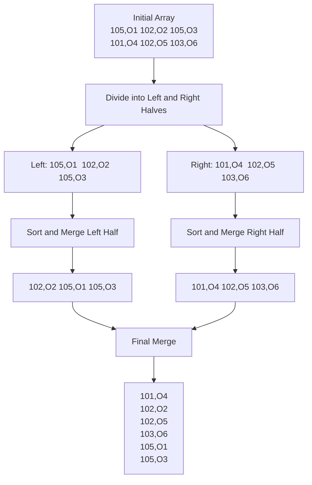
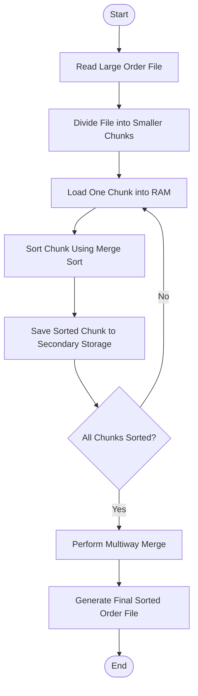

# MODULE 1 – MERGE SORT FOR NIGHTLY ORDER CONSOLIDATION

## 1. Aim

To design and implement a stable Merge Sort algorithm using the Divide-and-Conquer technique to arrange retail orders in ascending order of timestamps while preserving the original arrival order of orders having equal timestamps.

## 2. Problem Statement

KartIQ processes approximately 10,000,000 orders every day. These orders must be sorted according to their timestamps to generate nightly audit reports.

Orders received at the same second from different payment gateways must maintain their original arrival order. Therefore, a stable sorting algorithm is required.

### Sample Dataset

| Timestamp | Order ID |
|:---------:|:--------:|
| 105 | O1 |
| 102 | O2 |
| 105 | O3 |
| 101 | O4 |
| 102 | O5 |
| 103 | O6 |

## 3. Algorithm Explanation

Merge Sort is a Divide-and-Conquer sorting algorithm. It divides the input array into smaller subarrays, recursively sorts them and combines them into one sorted array.

### Three Main Operations

**1. Divide**

- Divide the original order list into two approximately equal halves.
- Continue dividing until every subarray contains one order.

**2. Conquer**

- Sort each smaller subarray recursively.
- A single-element array is already sorted.

**3. Combine**

- Compare the timestamps of elements from both sorted halves.
- Copy the smaller timestamp into the temporary array.
- When timestamps are equal, select the element from the left subarray first.
- This preserves the original arrival order.

## 4. Pseudocode

### Algorithm 1: MERGE_SORT

```text
MERGE_SORT(A, left, right)

    IF left < right THEN

        mid = (left + right) / 2

        MERGE_SORT(A, left, mid)

        MERGE_SORT(A, mid + 1, right)

        MERGE(A, left, mid, right)

    END IF

END
```

### Algorithm 2: MERGE

```text
MERGE(A, left, mid, right)

    Create temporary array TEMP

    i = left

    j = mid + 1

    k = 0

    WHILE i <= mid AND j <= right

        IF A[i].timestamp <= A[j].timestamp THEN

            TEMP[k] = A[i]

            i = i + 1

        ELSE

            TEMP[k] = A[j]

            j = j + 1

        END IF

        k = k + 1

    END WHILE

    Copy remaining elements from left half

    Copy remaining elements from right half

    Copy TEMP into A[left...right]

END
```

**Important:** The condition uses `<=` instead of `<`. This ensures that the left-side order is selected first when timestamps are equal, making Merge Sort stable.

## 5. Flowchart


## 6. Complete C Program

**File name:** `merge_sort.c`

```c
#include <stdio.h>
#include <stdlib.h>

struct Order
{
    int timestamp;
    char orderID[20];
};

void merge(struct Order a[], int left, int mid, int right)
{
    int i = left;
    int j = mid + 1;
    int k = 0;
    int size = right - left + 1;

    struct Order *temp =
        (struct Order *)malloc(size * sizeof(struct Order));

    if (temp == NULL)
    {
        printf("Memory allocation failed.\n");
        exit(1);
    }

    while (i <= mid && j <= right)
    {
        if (a[i].timestamp <= a[j].timestamp)
        {
            temp[k++] = a[i++];
        }
        else
        {
            temp[k++] = a[j++];
        }
    }

    while (i <= mid)
    {
        temp[k++] = a[i++];
    }

    while (j <= right)
    {
        temp[k++] = a[j++];
    }

    for (i = 0; i < size; i++)
    {
        a[left + i] = temp[i];
    }

    free(temp);
}

void mergeSort(struct Order a[], int left, int right)
{
    if (left < right)
    {
        int mid = left + (right - left) / 2;

        mergeSort(a, left, mid);

        mergeSort(a, mid + 1, right);

        merge(a, left, mid, right);
    }
}

int main()
{
    int n, i;

    printf("NIGHTLY ORDER CONSOLIDATION USING MERGE SORT\n");

    printf("Enter number of orders: ");
    scanf("%d", &n);

    if (n <= 0)
    {
        printf("Invalid number of orders.\n");
        return 1;
    }

    struct Order *orders =
        (struct Order *)malloc(n * sizeof(struct Order));

    if (orders == NULL)
    {
        printf("Memory allocation failed.\n");
        return 1;
    }

    printf("\nEnter timestamp and order ID:\n");

    for (i = 0; i < n; i++)
    {
        printf("Order %d: ", i + 1);

        scanf("%d %19s",
              &orders[i].timestamp,
              orders[i].orderID);
    }

    mergeSort(orders, 0, n - 1);

    printf("\nSORTED ORDER LIST\n");

    printf("-----------------------------\n");
    printf("Timestamp         Order ID\n");
    printf("-----------------------------\n");

    for (i = 0; i < n; i++)
    {
        printf("%-16d%s\n",
               orders[i].timestamp,
               orders[i].orderID);
    }

    free(orders);

    return 0;
}
```

## 7. Sample Input

```text
6
105 O1
102 O2
105 O3
101 O4
102 O5
103 O6
```

## 8. Expected Output


### Expected Output for the Six-Order Sample Dataset

```text
NIGHTLY ORDER CONSOLIDATION USING MERGE SORT

Enter number of orders: 6

Enter timestamp and order ID:
Order 1: 105 O1
Order 2: 102 O2
Order 3: 105 O3
Order 4: 101 O4
Order 5: 102 O5
Order 6: 103 O6

SORTED ORDER LIST
-----------------------------
Timestamp       Order ID
-----------------------------
101             O4
102             O2
102             O5
103             O6
105             O1
105             O3
```

## 9. Execution Trace

### Initial Array

```text
(105,O1) (102,O2) (105,O3)

(101,O4) (102,O5) (103,O6)
```

### Step 1: Divide

```text
                 Original Array
                       |
            -----------------------
            |                     |
         Left Half            Right Half
        (105,O1)              (101,O4)
        (102,O2)              (102,O5)
        (105,O3)              (103,O6)
```

### Step 2: Divide into Smaller Arrays

**Left Side:**

```text
(105,O1)   (102,O2)   (105,O3)
```

**Right Side:**

```text
(101,O4)   (102,O5)   (103,O6)
```

### Step 3: Merge the Left Half

```text
(105,O1) + (102,O2)

          |
          v

(102,O2) (105,O1)
```

**Merge with (105,O3):**

```text
          |
          v

(102,O2) (105,O1) (105,O3)
```

### Step 4: Merge the Right Half

```text
(101,O4) + (102,O5)

          |
          v

(101,O4) (102,O5)
```

**Merge with (103,O6):**

```text
          |
          v

(101,O4) (102,O5) (103,O6)
```

### Step 5: Final Merge

**LEFT:**

```text
102,O2   105,O1   105,O3
```

**RIGHT:**

```text
101,O4   102,O5   103,O6
```

```text
             |
             v
```

**FINAL SORTED ARRAY:**

```text
101,O4

102,O2

102,O5

103,O6

105,O1

105,O3
```

### Execution Trace Flowchart



## 10. Stability Verification

The original orders with timestamp 102 are:

```text
102,O2

102,O5
```

**After Sorting:**

```text
102,O2

102,O5
```

The original orders with timestamp 105 are:

```text
105,O1

105,O3
```

**After Sorting:**

```text
105,O1

105,O3
```

Therefore, the original arrival order is preserved.

## 11. Recurrence Relation

Merge Sort divides the input into two equal halves and merges them using linear time.

**The recurrence relation is:**

\[
T(n) = 2T(n/2) + O(n)
\]

**Where:**

- \(2T(n/2)\) represents sorting the two halves.
- \(O(n)\) represents merging the sorted halves.

### Using the Master Theorem

\[
a = 2,\quad b = 2,\quad f(n) = n
\]

\[
n^{\log_2 2} = n
\]

Therefore, Case 2 of the Master Theorem applies.

**Final Result:**

\[
T(n) = O(n\log n)
\]

| Case | Time Complexity |
|---|---|
| Best Case | \(O(n\log n)\) |
| Average Case | \(O(n\log n)\) |
| Worst Case | \(O(n\log n)\) |

### Complexity Analysis

| Complexity Type | Result | Explanation |
|---|---|---|
| Best Case | \(O(n\log n)\) | The array is divided and merged at every level. |
| Average Case | \(O(n\log n)\) | The algorithm performs recursive division and merging. |
| Worst Case | \(O(n\log n)\) | The algorithm maintains the same number of division levels. |
| Auxiliary Space | \(O(n)\) | Temporary arrays are required during merging. |

## 12. Production Workload Calculation

**Number of orders:**

\[
n = 10,000,000
\]

**Number of division levels:**

\[
\log_2(10,000,000) \approx 23.25
\]

**The approximate comparison count is:**

\[
n\log_2n-n+1
\]

\[
=10,000,000\times23.2535-10,000,000+1
\]

\[
\approx222,535,000\text{ comparisons}
\]

This is an approximate estimate, not an exact count for every input arrangement.

## 13. Memory Requirement

Merge Sort requires an additional temporary array to combine the sorted subarrays.

**Auxiliary Memory Complexity:**

\[
O(n)
\]

For 10,000,000 orders, assuming each record occupies 24 bytes:

\[
10,000,000\times24=240,000,000\text{ bytes}
\]

Approximately 240 MB for the records, plus temporary storage of a similar size.

The actual record size depends on the C compiler, structure padding and ID representation.

### Handling Data That Does Not Fit in RAM

KartIQ can use External Merge Sort.

**Steps:**

1. Divide the large order file into smaller chunks.
2. Load one chunk into RAM.
3. Sort the chunk using Merge Sort.
4. Save the sorted chunk to secondary storage.
5. Repeat for all chunks.
6. Merge the sorted files using a multiway merge.

This allows millions of orders to be sorted without loading the entire dataset into memory.

### External Merge Sort Flowchart



## 14. Advantages

- Guarantees \(O(n\log n)\) time complexity.
- Stable sorting preserves gateway arrival order.
- Suitable for large datasets.
- Predictable performance.
- Can be adapted for external sorting.

## 15. Limitations

- Requires additional memory.
- May involve more memory copying.
- Can be slower than Quick Sort for small in-memory arrays.

## 16. Optimisation Recommendation

KartIQ should use stable Merge Sort for nightly order consolidation.

For production, External Merge Sort can be used when the complete order dataset does not fit into RAM. Small subarrays can also be sorted using Insertion Sort to reduce recursion and merging overhead.

## Conclusion

Merge Sort is the appropriate choice because it provides predictable \(O(n\log n)\) performance and preserves the original arrival order of orders having identical timestamps.
